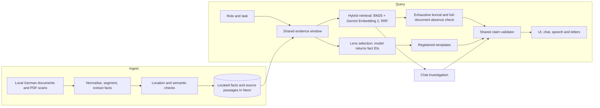

# Medlyn


> We turn a clinician's role and task into patient facts with evidence attached.

[Open the app](https://app.medlyn.health) · [Website](https://medlyn.health) ·
[Technical paper](paper/main.pdf)

## What it does

We build a source-linked view of German clinical documents around the job in front
of the clinician. We select located facts for template cards and link each line to
its passage, with the same evidence available to chat, speech and a GP letter.
We adjudicate contradictions against the same event and keep clarification requests
separate. We report missing documentation only after lexical and full-document
checks succeed; failed checks remain unavailable.

## Challenge metrics

We reviewed the five challenge situations with an empty review layer.
These are **agent-reviewed API screen results, not clinician-reviewed results or
browser visibility certification**. Sources: [METRICS.md](METRICS.md) and the
[question-level review](docs/submission/human-check.md).

<!-- biome-ignore format: The submission forbids triple-hyphen punctuation. -->
| Measure | Challenge target | Measured |
| :-- | :-- | :-- |
| Correct answers | 15/15 | 15/15 in each primary cold text/chip matrix |
| Traceability | 100% | 166/166 cited facts located; sampled lines 10/10 |
| Invented facts | 0 | 0 unsupported lines found in 167 distinct reviewed card lines |
| Contradictions | At least 5 net | 5 true, 0 false findings |
| Slowest load | Under 10 s | 10.138 s cold; 0.239 s confirmed cached |

**The slowest primary cold load of 10.138 s misses the under-10 s target.**
Cached loads take at most 0.239 s in this review. Additional uncached cache fills
were slower or returned unavailable cards. Both cached matrices scored 14/15 under
strict source/warning checks, so we do not claim all runs passed. The older automatic
regression and browser reports are separate runs, documented in METRICS.md.

## Architecture

We build two connected towers: ingestion establishes evidence; queries select and
validate statements against that evidence.



The core lens selects from all eligible facts of the relevant kinds. Hybrid search
supports investigation and absence checks. BM25 runs in process because the configured
Neon host rejects `pg_search`; vectors use pgvector. Vector quota/configuration failures
record a lexical fallback, while the full-document absence check remains mandatory.

<!-- biome-ignore format: The submission forbids triple-hyphen punctuation. -->
| Component | What we built | Connection |
| :-- | :-- | :-- |
| `apps/www` | Public landing page | Links into the patient app |
| `apps/app` | Chat, Situations, evidence, reviews, letters and API routes | Calls the shared engine; streams validated results |
| `packages/engine/ingest` | Extraction, location, support checks and translation | Publishes evidence to Neon |
| `packages/engine/search` | Scoped BM25, vectors and reciprocal rank fusion | Uses the store's patient, revision and window |
| `packages/engine/lens` | Needs planning, fact selection, absence and templates | Returns source-linked cards |
| `packages/engine/claims` | Common validation and cache identity | Gates every patient statement |
| `packages/engine/agent`, `reviews`, `letter` | Investigation and drafting workflow | Reuses evidence and append-only reviews |
| `eval`, `ml`, `paper` | Evaluation, synthetic data and research reports | Keep populations separate; generate paper values from result files |

### Models and services

<!-- biome-ignore format: The submission forbids triple-hyphen punctuation. -->
| Model or service                                 | Role                                                                                                                |
| :-- | :-- |
| OpenAI GPT through an OpenAI-compatible endpoint | `MODEL_REASONING` for extraction/judging; `MODEL_FAST` for selection and live checks; model IDs stay in root `.env` |
| Gemini Embedding 2                               | Optional text/page retrieval vectors; never evidence by themselves                                                  |
| Neon Postgres                                    | Documents, located facts, findings, caches, reviews and letters                                                     |
| Qwen3-1.7B QLoRA in MLX                          | Local research verifier; GPT remains the application default                                                        |
| fish.audio                                       | Optional text-to-speech for validated text; browser synthesis fallback                                              |
| Browser speech recognition                       | Feature-detected dictation through the typed-text path                                                              |
| IBM Quantum / Qiskit                             | Synthetic kernel and QAOA experiments outside the product                                                           |
| Hugging Face                                     | Base-model and MLX conversion distribution                                                                          |
| Vercel                                           | Hosting for the landing page and patient app                                                                        |

## Engine guarantees

- We store facts only with located source quotes and checked sensitive values.
- We route patient statements through one claim boundary across output channels.
- We let models select fact IDs, then render registered templates.
- We prove absence across the eligible record; failures show “Couldn't check”.
- We use one patient, corpus revision and evidence window throughout each request.
- We append reviews without changing source facts or machine validation results.

## Own model and research

We generated **100,000 synthetic patients** locally from fresh templates.
The corpus is distinct from the patients ingested into Neon, and code-checked
labels are not clinician gold. See the [generator](ml/synth/README.md).

We adapted a quantised Qwen3 base with LoRA in MLX. The full-data run hit its time
cap before completing its epoch. The table reports separate test populations from
[the saved verifier results](ml/verifier/results.json); the `real-gold` file label
denotes a test-only rule-labelled real-text set, not clinician annotation.

<!-- biome-ignore format: The submission forbids triple-hyphen punctuation. -->
| Method | Synthetic held-out macro-F1 | Real-text macro-F1 |
| :-- | --: | --: |
| Rules | 0.295 | 0.301 |
| Local QLoRA | 0.764 | 0.421 |
| GPT | 0.896 | 0.657 |
| Local + GPT cascade | 0.956 | 0.616 |

The synthetic cascade projects **55% fewer GPT calls** in offline replay,
where both predictions were collected. It trails GPT on real text and is not promoted
to the application validator. See [results](ml/verifier/RESULTS.md),
[model card](ml/verifier/model-card.md) and [paper](paper/main.pdf).

On `ibm_marrakesh`, we ran 136 overlap circuits at median transpiled depth
760, with 52.9 s execution time and 0.066 mean absolute error against the
simulator kernel block. This small character-hash control establishes no quantum
or clinical advantage. See the [quantum experiment](ml/quantum/README.md).

## What works and what does not

We support source-linked clinical views, adjudicated findings, investigation,
review and cited letter drafting. The primary cold answer checks pass, but cold
latency misses the challenge target and repeated cached checks expose source and
warning failures. The local verifier trails GPT on real text. We removed unmeasured
browser, blind-relevance and vector-only results from the paper. The public demo
has **no authentication** and is a hackathon prototype.

## Run it locally

### Development setup

Prerequisites: Node 24+, pnpm 10.18.0, Python 3.12 with uv, a Neon database,
an OpenAI-compatible endpoint/key and configured model roles. Gemini is optional.

```sh
pnpm install
cp .env.example .env
# Configure the root .env, including DATABASE_URL and MEDLYN_DATA_PATH.
# Follow packages/engine/search/README.md for fresh-database extension setup.
pnpm db:push
pnpm ingest
pnpm warm
pnpm dev
```

Set `MEDLYN_DATA_PATH` to the supplied patient corpus directory containing
`documents/`, relative to the repository root (an absolute path also works).
For example, place the privately supplied corpus under `data/` and point the variable
at its patient directory. **The Track 1 data folder is not included in this repository.
Never commit `data/`, challenge text, dumps, weights or `.env`.** Configuration belongs
only in the root `.env`; [.env.example](.env.example) lists the variables.

Open the [patient app](http://localhost:3000) and [landing page](http://localhost:3001).
Set `NEXT_PUBLIC_SITE_URL` and `NEXT_PUBLIC_APP_URL` before a production build.

```sh
pnpm typecheck
pnpm test
pnpm lint
pnpm build
pnpm eval --suite real
```

The real evaluation command also schedules the protected blind worker. Only run it
after the orchestrator authorises that gate; before it, request a regression-only run.
This submission update did not run the real or blind suite.

From `ml/`, use the installed uv environment:

```sh
uv run python -m synth.generate --help
uv run python -m synth.materialise --help
uv run python -m verifier.evaluate --help
uv run ruff check .
uv run python -m pytest
```

See [ML setup](ml/README.md), [evaluation](eval/README.md),
[search setup](packages/engine/search/README.md) and [deployment](docs/deploy.md).
Build the paper with `make -C paper`; check extraction with `make -C paper test`.
The [paper runbook](paper/README.md) explains frozen results and source hashes.

## Workspace

<!-- biome-ignore format: The submission forbids triple-hyphen punctuation. -->
| Path | Responsibility |
| :-- | :-- |
| `apps/www` | Public landing page |
| `apps/app` | Patient app, chat, Situations and API routes |
| `packages/engine` | Evidence, ingest, retrieval, claims, agent, reviews and letters |
| `packages/tsconfig` | Shared strict TypeScript configuration |
| `eval` | Separate real/synthetic suites and browser/retrieval checks |
| `ml` | uv-managed synthetic data, PDF tooling, MLX and quantum research |
| `paper` | LaTeX report, generated aggregates and Tectonic build |
| `docs` | Specification, architecture, decisions, status and design guidance |

## Stack

<!-- biome-ignore format: The submission forbids triple-hyphen punctuation. -->
| Layer | Technology |
| :-- | :-- |
| Web | Next.js, React, TypeScript, shadcn/ui, Tailwind, Hugeicons |
| AI and evidence | AI SDK, Zod, Drizzle, Neon, BM25, pgvector, Gemini embeddings |
| Research | Python, uv, MLX, Qiskit, pytest, ruff |
| Tooling | pnpm, Turborepo, Vitest, Playwright, Biome, Husky, Tectonic |

### Design principles

We keep evidence outside model parameters, distinguish missing documentation from
failed checks, preserve historical source/date labels, and keep evaluation populations
separate. We keep source text and model artifacts local. See [architecture](docs/architecture.md),
[decisions](docs/decisions.md) and [status](docs/status.md) for implementation limits.

## Team

<p align="center">
  <a href="https://github.com/julian-at"></a>
</p>
