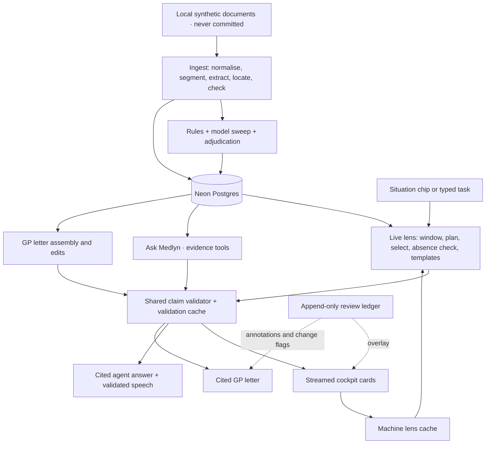

# Medlyn

Medlyn turns a clinician's role and task into one screen of relevant patient facts, each linked to its original sentence or medication table row. It reads eight German documents for one synthetic patient and presents English cards, explicit documentation gaps and adjudicated conflicts. The same evidence supports an investigation dock and a GP follow-up letter. Built for IBM Austria's Track 1 clinical documentation challenge.

<!-- Submission screenshot: the integrator adds docs/screenshot.png. -->


## Architecture



The engine precomputes evidence and findings during ingestion. Live requests select from stored facts within one evidence window, then validate claims before displaying them. Reviews are applied separately from cached machine output. See the [architecture guide](docs/architecture.md) for storage, validation and output details.

The components below have implementations in the tree. Their presence does not establish end-to-end correctness or measured performance. The lens API can replay a **labelled mock** if the live engine fails before streaming; live evaluation rejects that fallback. Submission claims require a live run and human-checked metrics.

| Component | Responsibility |
| --- | --- |
| Engine: ingestion | Normalisation with offset mapping, segmentation, medication parsing, model extraction, quote location, semantic and negation checks, translation and concept coverage. |
| Engine: findings | Candidate rules and model sweep followed by adjudication; retains source passages for conflicts and clarification requests. |
| Engine: store and database | Neon tables accessed through Drizzle; the store defines the shared eligible document set. |
| Engine: lens | Situation parsing, needs catalog and profiles, parallel fact selection, full absence checks, template rendering, NDJSON streaming and warm cache. |
| Engine: claims | Shared claim validation, sensitive-token checks, semantic support and full cache identity. |
| Engine: reviews | Append-only clinician decisions and a reversible display overlay. |
| Engine: agent | Window-scoped evidence tools, timeline, arithmetic, answer gating and validated speech receipts. |
| Engine: letter | Template-first GP letter, sentence validation, clinician annotations and review-change flags. |
| Engine: contracts | Shared Zod schemas for facts, claims, screens, streams, reviews and letters. |
| Web app | Next.js cockpit, source panel, review controls, letter panel and assistant-ui investigation dock; server routes connect them to the engine. |
| Evaluation | promptfoo answer and grounding checks, citation and contradiction audits, and Playwright visibility and timing checks. |
| A+ search (approved, in progress) | Gemini Embedding 2 vectors + ParadeDB BM25 in Neon, reciprocal rank fusion, shared evidence window; absence stage (a) and agent search. |
| A+ multimodal (approved, in progress) | PDF/scan text extraction with page and bounding-box provenance; ordinary quote location and validation; page vectors retrieve sources. |
| A+ synthetic data (approved, in progress) | 100k code-rendered German patient histories, exact spans and mutation labels; at most 300 LLM rewrites, about 100 patients ingested, 20 fresh sample patients in git. |
| A+ verifier (approved, in progress) | Claim/passage dataset and MLX quantised-base LoRA on the Mac; optional local semantic backend, promoted only after held-out comparison. |
| A+ evaluation and paper (approved, in progress) | At least 150 challenges over 50 synthetic patients; separate retrieval/verifier reports; arXiv preprint with tables generated from evaluation outputs. |

[PRD v3](docs/PRD.md) defines the approved A+ scope and three-hour execution cap. The real-patient 15/15 regression and demo keep priority. A+ rows describe delivery targets until the owning lane verifies them. All visible UI uses existing shadcn/ui primitives, preset `b1aIcEuKO` and the `dashboard-01` shell; assistant-ui supplies the dock runtime and structure.

## How a situation becomes a screen

1. **Fix the evidence window and parse the task.** The store includes only documents dated on or before the selected as-of date. A configured situation chip skips model parsing; free text uses the fast model.
2. **Plan the needs.** A configured profile supplies sections and required information. For an unfamiliar role, the model chooses needs from the fixed catalog. Critical needs are added by code.
3. **Select facts.** Section calls run in parallel over eligible facts of relevant kinds. The model returns fact IDs, completeness and an optional headline; templates produce card lines.
4. **Check apparent gaps.** Empty selections trigger synonym search and a full-text model pass across every eligible document. Hits can trigger selection again. A complete empty search permits “Not documented”; failure or timeout produces “Couldn't check”.
5. **Render and validate.** Templates preserve source dates, assertion and temporal status. The shared validator checks card claims and optional composed headlines; rejected headlines leave the template lines. Eligible adjudicated findings accompany the screen.
6. **Stream and cache.** Section titles arrive first, followed by completed sections, validated headlines, findings and timings. Cacheable machine screens are stored; session reviews are applied as an overlay.

Latency budgets are targets, not measured results: first card below **1.5 s**, complete cold screen below **5 s**, cached screen below **1 s**. Proxy smoke tests recorded an approximately **1.25 s** call floor, with larger-model structured calls reaching **4.4 s**. Chips avoid the parse call; sections and absence checks overlap. Typed tasks and unfamiliar roles can require extra serial calls. The challenge limit is a complete screen below **10 s**.

## Trust model

These are implementation requirements; evaluation checks whether they hold.

1. **Located evidence:** each fact needs a quote found at exact normalised document offsets, including its numbers, dates, doses and laterality. Location failures are dropped and logged.
2. **One claim boundary:** patient statements in cards, headlines, answers, speech and letters pass the same validator. Unsupported composed text is withheld or falls back to checked templates.
3. **Models select; templates render:** the card model chooses evidence IDs rather than writing clinical card text.
4. **Absence requires a complete search:** synonym search and the full-document model check must both finish. Missing documentation never proves a negative clinical finding.
5. **One evidence window:** selection, absence searches, findings, agent tools and letters share the same eligible document IDs and corpus revision.
6. **Independent states:** availability, assertion, temporal status, completeness, conflict and review remain separate. A recommendation is not proof that an investigation occurred.
7. **Reviews are an overlay:** append-only decisions do not rewrite documents, facts or validation results. Evaluation uses an empty review layer.
8. **Complete cache identity:** patient, corpus revision, evidence window, validator version, normalised claim text, cited fact IDs with content hashes, and segment IDs all participate.
9. **Conflicts are adjudicated:** only contradictions and clarification requests reach the screen. Medication changes over time and ordinary measurement variation are not automatically contradictions.
10. **Medication retains its source:** lists identify the originating document and date; historical lists are never presented as “current medication”.

## Models and services

| Service | Use and configuration |
| --- | --- |
| GPT models through an OpenAI-compatible proxy | `OPENAI_BASE_URL` and `OPENAI_API_KEY` configure access. `MODEL_REASONING` handles extraction, findings work and the evaluation judge; `MODEL_FAST` handles parsing, planning, selection, absence and semantic checks, translation and the agent. Model IDs are chosen in the environment. |
| Neon Postgres + Drizzle | `DATABASE_URL` stores source evidence, facts, findings, validation results, screens, reviews and letters. `DATABASE_URL_DEMO` is reserved for the submission demo database. |
| fish.audio | `FISH_AUDIO_API_KEY` and `FISH_AUDIO_VOICE_ID` enable TTS of validated answer text. The browser has a speech-synthesis fallback. |
| Browser speech recognition | Feature-detected push-to-talk sends transcripts through the text path. Unsupported browsers hide voice input; no transcription model or polyfill is required. `MODEL_STT` stays empty. |
| Gemini Embedding 2 (A+) | `GEMINI_API_KEY` enables text and page/image embeddings; vectors support retrieval and never replace located evidence. |
| Neon hybrid indexes (A+) | pgvector stores segment vectors; ParadeDB `pg_search` provides BM25 over German/English segments. About 100 synthetic patients enter Neon; the 100k-patient dataset stays local. |
| Local verifier (A+, optional) | `MEDLYN_VERIFIER=local` selects the trained MLX backend. About 5k examples, one epoch, a ~1.5–1.7B 4-bit Qwen3 base, seq ≤512, ≤45 min training on the M4 Pro Mac. Unset keeps GPT; switch only after equal-or-better held-out results. |
| Synthetic proxy jobs (A+) | `MEDLYN_LLM_CONCURRENCY` limits requests per process (default 8). Synthetic jobs set it to 3 and yield to real regression work. It does not coordinate limits across processes. |

Engine structured calls use a thin fetch client with JSON-schema output, Zod validation and one retry for malformed output. AI SDK v7 and its OpenAI provider handle the agent's tool loop; assistant-ui supplies the dock. The A+ local verifier is an optional backend pending training and held-out evaluation; it is not a default-service change. A+ training does not require the H100.

## Run locally

Use Node.js 24 or newer and pnpm 10.18.0. Obtain the challenge data separately and access to the proxy and a Neon database. From the repository root:

```sh
pnpm i
cp .env.example .env
# Fill in .env before continuing.
pnpm db:push
pnpm ingest --data <path>
pnpm warm
pnpm dev
# In a second terminal, after the web app starts:
pnpm eval
```

Replace `<path>` with the patient directory containing `patient.json`, `documents.json` and `documents/`. Set `MEDLYN_DATA_PATH` in the root `.env` to the same directory, relative to the repository root or absolute. Set the proxy URL, API key, both model roles and database URL; Fish credentials are needed for Fish speech output. Scripts and the web configuration load the root `.env`.

Open [localhost:3000](http://localhost:3000). Ingestion currently also warms the configured situations; `pnpm warm` explicitly refreshes them. `pnpm smoke` checks proxy capabilities and latency. `pnpm typecheck` and `pnpm test` run workspace checks.

`pnpm eval` writes machine results under `eval/output/`; browser checks require the web server and Playwright's Chromium to be available. Run the held-out evaluation only after the H+7 checkpoint, and do not inspect or tune against its results beforehand. Human-check results before publishing submission metrics in `METRICS.md`; targets and mock output are not results.

A+ command contract (planned until the implementing lanes report verification):

| Command or CLI operation | Purpose and limit |
| --- | --- |
| `pnpm eval --suite real` | Five real-patient regression situations; real blind results stay closed until H+7 |
| `pnpm eval --suite synthetic` | At least 150 synthetic challenges over 50 ingested patients |
| `pnpm eval --suite all` | Run eligible suites and emit separate reports; never bypass the real blind gate or pool scores |
| `uv run python -m synth.generate` / `synth.materialise` | From `ml/`: generate 100k seeded patients and materialise the corpus JSON format |
| `uv run python -m synth.render_pdf` / `synth.rewrite` | From `ml/`, planned: PDF/scan inputs; prose rewrites for at most 300 patients |
| `uv run python -m verifier.train` / `verifier.evaluate` | From `ml/`: verifier train/eval within the cap; compare with GPT and rules |
| `make -C paper` | Build the arXiv preprint with tectonic; tables and figures come from evaluation outputs |

Run Python commands from `ml/` using uv; each module in the table needs the full `uv run python -m` prefix. Build verifier inputs with `uv run python -m verifier.build_dataset` before training. Ruff and pytest are the Python checks; use each module’s `--help` for flags. The synth PDF/rewrite entry points remain planned until delivered by that lane. Set `GEMINI_API_KEY` in the root `.env` before embedding; schema and BM25 setup can proceed without it. Leave `MEDLYN_VERIFIER` unset for GPT. Python jobs must receive the root environment; do not create per-package `.env` files.

Keep bulk synthetic shards, rendered PDFs/scans, weights and adapters local and gitignored; only the fresh 20-patient synthetic sample may be committed. Never use challenge text in templates or training. Split by patient and generation family before rewriting. Real regression, real blind held-out, synthetic pipeline, retrieval and verifier results have separate denominators; no combined score. Paper numbers must be human-checked. The [PRD dependency table](docs/PRD.md#dependencies) records A+ licences, including PyMuPDF's AGPL/commercial terms and the upstream Qwen3 model licence.

## Data handling

Only synthetic patient data is in scope. Challenge data is loaded at runtime and must never be published in this repository. Keep `data/`, `TRACK-1-clinical-documentation/`, archives, database dumps and `.env` out of git. This also applies to copied document text in code, fixtures, prompts, commit messages and PR descriptions; use passage references such as `documentId@start–end` instead.

Installation configures the pre-commit hook. Its data check blocks forbidden paths and checks staged content for 120-character source passages when the local corpus is available. Without the corpus, it checks paths only. Never bypass it. Evaluation output can contain patient evidence and must remain local. Any hosted submission demo must be password protected.

## Dependency licences

Direct third-party dependencies declared in the workspace manifests are listed below. Licence names were checked against installed package metadata and licence files; this is not a transitive dependency inventory. The internal `@medlyn/engine` workspace reference adds no third-party dependency.

| Dependency | Use | Licence |
| --- | --- | --- |
| `next`, `react`, `react-dom` | Web application | MIT |
| `tailwindcss`, `@tailwindcss/postcss` | Styling | MIT |
| `motion` | UI animation | MIT |
| `geist` | Fonts | SIL Open Font License 1.1 |
| `ai`, `@ai-sdk/openai` | Agent tool loop and proxy provider | Apache-2.0 |
| `@assistant-ui/react`, `@assistant-ui/react-ai-sdk` | Investigation dock | MIT |
| `@neondatabase/serverless` | Database driver | MIT |
| `drizzle-orm` | Database queries and schema | Apache-2.0 |
| `drizzle-kit` | Schema tooling | MIT |
| `zod` | Runtime contracts and structured output | MIT |
| `promptfoo` | Evaluation | MIT |
| `@playwright/test` | Browser checks | Apache-2.0 |
| `vitest` | Unit tests | MIT |
| `turbo` | Workspace tasks | MIT |
| `typescript` | Type checking | Apache-2.0 |
| `@types/node`, `@types/react`, `@types/react-dom` | Type definitions | MIT |
| Borrowed [pynegex German trigger list](https://github.com/DFKI-NLP/pynegex/blob/a4cabe5c1203bd6b0590afca20a55c3a6a8c8c2a/pynegex/model/triggersets/cotik-de.txt) | 512 triggers ported to TypeScript with bounded-scope matching; attribution and upstream licence retained in the source | Python Software Foundation licence, including upstream notices |

## What works / what doesn't

### What works

### What doesn't
