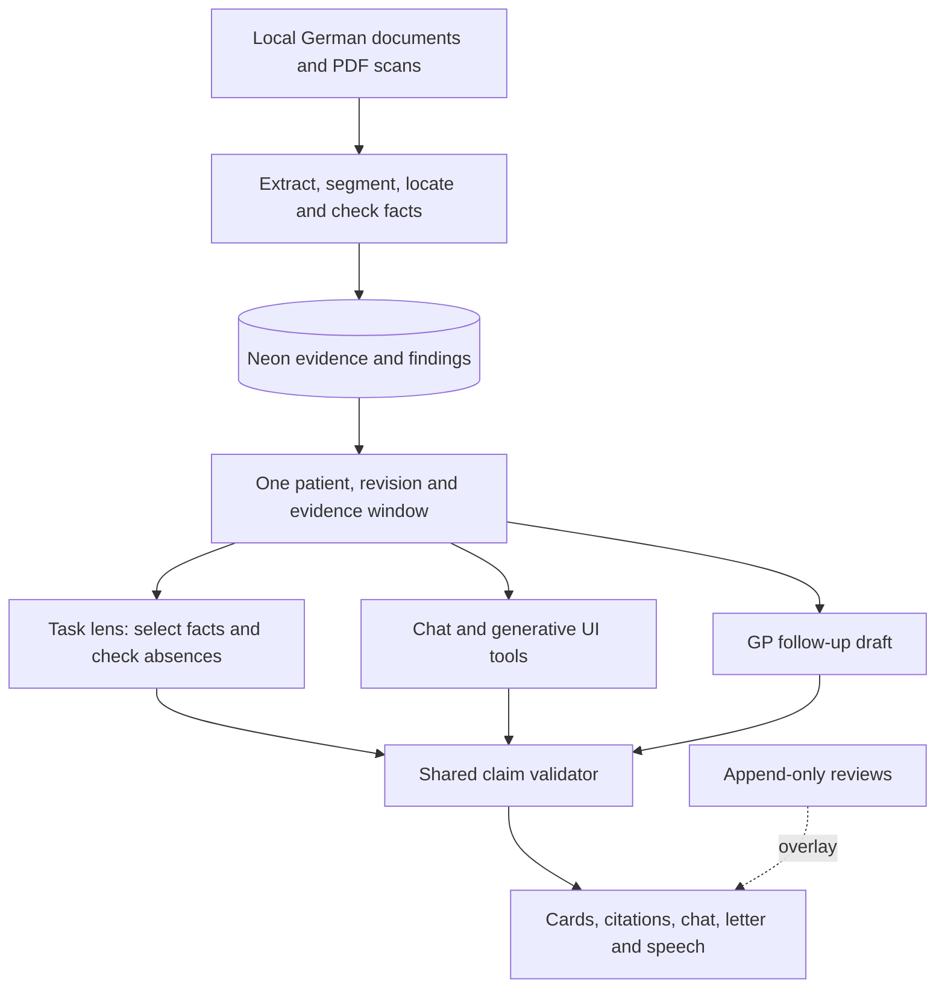

# Medlyn

The patient facts your task needs, with sources. Medlyn turns a clinician's role
and task into an English view of German clinical documents: located facts,
source-labelled medication lists, explicit documentation gaps and adjudicated
conflicts. Chat can open clinical views, inspect evidence and draft a cited GP
follow-up letter. Built for IBM Austria's Track 1 clinical documentation challenge.

This is a hackathon prototype using synthetic/demo records. Automated real
regression reaches **15/15**, pending human screen review. Cold latency, multimodal
agreement and synthetic evaluation coverage still miss acceptance targets. See
[build status](docs/status.md) for measured results and their denominators.

## Two applications

| App                 | Workspace                  | Local URL                               | Deployment example        |
| ------------------- | -------------------------- | --------------------------------------- | ------------------------- |
| Public landing page | `apps/www` · `@medlyn/www` | [localhost:3001](http://localhost:3001) | `https://example.com`     |
| Patient app         | `apps/app` · `@medlyn/app` | [localhost:3000](http://localhost:3000) | `https://app.example.com` |

Names above describe the final layout. The integration sweep renames the earlier
`apps/web` / `@medlyn/web` package; until that lands, its scoped commands use the
old name. Example domains are placeholders, not deployed demos.

The public site preserves the supplied design. The patient app uses a neutral
ElevenLabs-inspired shadcn shell with chat home/history, patient category pages,
Situations, source inspection, reviews and letters. Research destinations remain
publication slots where verified reports have not yet been integrated.

## How it works



Ingest computes evidence and findings before live requests. Models select fact IDs;
templates write card lines. Composed answers and letter sentences pass the same
claim validator. Every component shares the document-date evidence window.
"Not documented" requires exhaustive lexical checks plus a successful full-text
pass over all eligible documents; a failed check becomes "Couldn't check".
Vector search supplements retrieval and may fall back under quota limits.

Reviews change presentation through an append-only ledger. They do not rewrite
source facts or validation results. The lens API labels mock fallback explicitly;
mock output never counts as live evaluation evidence. The
[architecture guide](docs/architecture.md) explains module boundaries, caches,
chat tools, source provenance and current limitations.

## Quickstart

Use Node.js 24+, pnpm 10.18.0, an OpenAI-compatible model proxy and Neon Postgres.
Obtain the challenge corpus separately. From the repository root:

```sh
pnpm install
cp .env.example .env
# Fill in proxy credentials, MODEL_REASONING, MODEL_FAST, DATABASE_URL,
# and MEDLYN_DATA_PATH before continuing.
pnpm smoke
# A fresh database needs search extensions before the vector-bearing schema.
node --env-file=.env --experimental-strip-types packages/engine/db/migrations-extra/apply.ts --extensions-only
pnpm db:push
node --env-file=.env --experimental-strip-types packages/engine/db/migrations-extra/apply.ts
pnpm ingest
pnpm warm
# Public URLs must be exported for the landing app; use real HTTPS origins at deployment.
export NEXT_PUBLIC_SITE_URL=http://localhost:3001
export NEXT_PUBLIC_APP_URL=http://localhost:3000
pnpm dev
```

`MEDLYN_DATA_PATH` points to a patient directory containing `patient.json`,
`documents.json` and `documents/`, relative to the repository root or absolute.
`pnpm ingest --data <path>` provides an explicit override. Ingest also warms the
configured situations by default; `pnpm warm` refreshes them explicitly.

Engine scripts and the patient app load the root `.env`; the landing app uses its
build environment. Do not create package-specific `.env` files. Installation runs
Husky preparation; verify `git config --get core.hooksPath` is `.husky/_` before
committing. Never bypass hooks. See the [search guide](packages/engine/search/README.md)
for extension setup, embedding backfill and synthetic imports. The configured Neon
host rejects `pg_search`; the engine uses scoped in-process BM25 instead.

## Commands

| Command                                      | Purpose                                                            |
| -------------------------------------------- | ------------------------------------------------------------------ |
| `pnpm dev` / `pnpm build`                    | Both apps in development / workspace production builds             |
| `pnpm typecheck` / `pnpm test` / `pnpm lint` | Turbo tasks for workspaces defining those scripts                  |
| `pnpm check` / `pnpm format`                 | Biome repository checks / formatting                               |
| `pnpm smoke [model…]`                        | Proxy capability and latency checks                                |
| `pnpm lens --chip <id> --no-cache`           | Cold engine lens inspection                                        |
| `pnpm eval --suite real`                     | Real regression and blind worker; only after authorised H+7 review |
| `pnpm eval --suite synthetic`                | Separate synthetic pipeline/retrieval/verifier reporting           |
| `pnpm eval --suite all`                      | Both suite paths, separate reports; same blind restriction         |
| `make -C paper` / `make -C paper test`       | Build preprint / test aggregate generation                         |

The real runner currently schedules held-out work automatically; it is not a
regression-only command. Keep blind results closed until the orchestrator's H+7
review. Browser visibility/timing requires a running patient app and a launchable
Playwright browser. Outputs under `eval/output/` can contain patient evidence and
remain private. Human-check numbers before publishing `METRICS.md` or paper claims.

Python commands run from `ml/` using uv, ruff and pytest:

```sh
uv run python -m synth.generate --n 100000 --out data/new-corpus --workers 8
uv run python -m synth.materialise --data data/sample --patient synth-000000 --out /private/tmp/synth-patient
uv run python -m synth.render_pdf --data data/sample --patient synth-000000 --out /private/tmp/synth-pdf --scan
uv run python -m synth.rewrite --data data/new-corpus --n 300
uv run python -m verifier.build_dataset
uv run python -m verifier.train --minutes 44
uv run python -m verifier.evaluate --local --proxy --limit 90
uv run python -m pytest
uv run ruff check .
```

Generation destinations must be new; never rewrite challenge inputs. Read the
[synthetic corpus](ml/synth/README.md) and [verifier](ml/verifier/README.md) guides
before starting jobs. Bulk data and adapters stay local. The 100k generated
patients are not 100k ingested records; code-checked synthetic labels are not
human gold. The optional local verifier scores below GPT and is not promoted.

## Models and services

| Service                    | Role and configuration                                                                                                                                                      |
| -------------------------- | --------------------------------------------------------------------------------------------------------------------------------------------------------------------------- |
| OpenAI-compatible proxy    | `OPENAI_BASE_URL`, `OPENAI_API_KEY`; `MODEL_REASONING` for extraction/judging, `MODEL_FAST` for live selection, chat and semantic checks. No hard-coded language-model IDs. |
| Structured engine client   | Fetch + JSON schema + Zod validation; one malformed-output retry. `MEDLYN_LLM_CONCURRENCY` defaults to 8 per process; synthetic jobs use 3.                                 |
| AI SDK v7 and AI Elements  | Chat/tool streaming and generative clinical views; persisted validated message parts in Neon. Replaces the earlier assistant-ui dock.                                       |
| Neon + Drizzle             | Documents, facts, findings, caches, reviews, letters and chat history. `DATABASE_URL`; optional separate frozen demo connection.                                            |
| Gemini Embedding 2         | Optional text/page retrieval vectors through `GEMINI_API_KEY`; default pacing 80 inputs/min/process. Located text, not embeddings, establishes evidence.                    |
| Local MLX verifier         | Quantised-base Qwen3 LoRA research and HTTP client. `MEDLYN_VERIFIER=local` gates that client, but the shared validator does not invoke it; leave unset for GPT.            |
| fish.audio                 | Optional TTS via `FISH_AUDIO_API_KEY` and `FISH_AUDIO_VOICE_ID`; signed validated text only, browser speech synthesis fallback.                                             |
| Browser speech recognition | Feature-detected push-to-talk uses the typed-text path; unsupported browsers hide it. `MODEL_STT` remains empty.                                                            |

No self-hosted vLLM inference service is integrated. A hosted demo needs real access
control: the reserved `DEMO_PASSWORD` setting alone is not enforced. Public origins
are build-time configuration; patient-app noindex headers and robots rules do not
provide authentication. See [SEO](docs/seo.md) for indexing/deployment checks.

## Data and licences

Challenge data must never reach git. This includes `data/`,
`TRACK-1-clinical-documentation/`, archives, dumps, `.env` and copied document text
in source, tests, prompts, commit messages or PR bodies. Load it at runtime and
reference passages as `documentId@start–end`. Husky runs the data guard before
staged Biome and ruff; commit-msg enforces Conventional Commits. A missing local
corpus reduces the guard to path checks, not permission to publish text.
Only the fresh 20-patient synthetic sample may be committed from bulk data.

The root tree has no project-wide licence declaration. Third-party package
licences do not establish rights to the supplied landing design, media or fonts.
The user chose to preserve them as-is and acknowledged the **ABC Marist font and
third-party design/asset licence risk**; their reuse/distribution rights remain
unverified. Waldenburg is not bundled; the patient app uses Inter/Geist Mono.

Selected dependency groups below reflect installed package metadata and retained
notices, not a complete transitive licence audit:

| Dependency or asset                                                                     | Licence / terms                                                                         |
| --------------------------------------------------------------------------------------- | --------------------------------------------------------------------------------------- |
| Next.js, React, Tailwind, Motion, shadcn, Radix/Base UI, Hugeicons                      | MIT                                                                                     |
| Recharts, TanStack Table, dnd-kit, XYFlow, Embla, cmdk, Sonner, Vaul, next-themes       | MIT                                                                                     |
| Shiki, tokenlens, cn, clsx, tailwind-merge, tw-animate-css, nanoid, use-stick-to-bottom | MIT                                                                                     |
| Lenis, dotLottie React                                                                  | MIT                                                                                     |
| AI SDK (`ai`, `@ai-sdk/*`), Streamdown, class-variance-authority                        | Apache-2.0                                                                              |
| Drizzle ORM, TypeScript, Playwright                                                     | Apache-2.0                                                                              |
| Neon driver, Drizzle Kit, Zod, Vitest, promptfoo, Turbo, Husky, type definitions        | MIT                                                                                     |
| Biome                                                                                   | MIT OR Apache-2.0                                                                       |
| Lucide (retained dependencies, including landing)                                       | ISC; app code convention uses Hugeicons                                                 |
| `gsap`, `@gsap/react`                                                                   | GSAP standard licence; preserve its installed terms                                     |
| Geist fonts / Inter                                                                     | SIL Open Font License; retain font notices                                              |
| Ported pynegex German negation triggers                                                 | Python Software Foundation-style terms; upstream licence/attribution retained in source |
| MLX-LM / upstream Qwen3 weights                                                         | MIT / Apache-2.0; preserve selected conversion and adapter provenance                   |
| ReportLab / PyMuPDF                                                                     | BSD / AGPL or commercial; address applicable distribution/hosting obligations           |
| pgvector / optional ParadeDB                                                            | PostgreSQL / AGPL-3.0; ParadeDB is unavailable on this Neon host                        |
| Tectonic and downloaded TeX assets                                                      | MIT engine; TeX assets retain their own licences                                        |
| Proxy, Gemini and fish.audio                                                            | Hosted service terms; not open-weight licences                                          |

Start contributing with [AGENTS.md](AGENTS.md). The [documentation index](docs/README.md)
links the specification, architecture, decisions, measured status and research guides.
