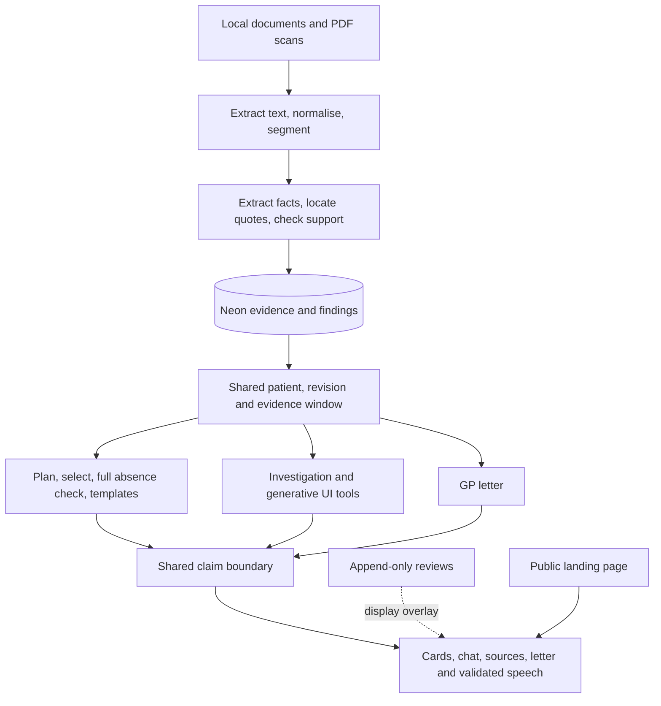

# Architecture

Medlyn turns a clinician's task into source-linked patient facts. The patient app
is chat-first, with generative clinical views and a dedicated Situations cockpit.
A separate public landing page carries product information. Part A demonstrates
one challenge patient; A+ adds isolated synthetic corpora, multimodal ingestion,
retrieval and verifier research. These are prototype capabilities, not production
clinical validation. See [status](status.md) for measured coverage and open gates.

## Applications and modules

| Module                     | Boundary                                                                                                     |
| -------------------------- | ------------------------------------------------------------------------------------------------------------ |
| `apps/www`                 | Public Next.js landing page, root domain, port 3001; no patient-data metadata                                |
| `apps/app`                 | Next.js patient app/API, app subdomain, port 3000; chat, patient categories, Situations, reviews and letters |
| Engine ingest/findings     | Local corpus → located facts, translations, entities and adjudicated findings                                |
| Engine store/search        | Shared patient/revision/window reads, BM25, pgvector and fusion                                              |
| Engine lens/claims         | Need planning, fact selection, absence checks, templates and shared output gate                              |
| Engine agent/review/letter | Investigation tools, validated chat history, review overlay and GP draft                                     |
| Evaluation/research        | Separate real, synthetic, retrieval and verifier reports; generated paper aggregates                         |

Paths use the final `apps/app` / `@medlyn/app` names. The integration sweep renames
the earlier `apps/web` / `@medlyn/web` tree. [Decisions](decisions.md) records this
and the migration from the assistant-ui dock to AI SDK v7 with AI Elements.

## Ingestion and publication

Runtime loading resolves the corpus from the root `MEDLYN_DATA_PATH`. A revision
hash identifies its input. Normalisation decodes entities and line breaks while
keeping raw-offset mapping. Segments preserve UTF-16 offsets into normalised text,
including medication rows, headings and sentences. Document IDs derive from
filenames; segment IDs combine document ID and ordinal; fact IDs derive from
stable content hashes.

A deterministic medication parser and reasoning-model extraction/recall produce
facts. Location checks find quotes and check sensitive numbers, dates, doses,
sides and ordered schedules. Semantic support, German negation flags, translation
and entity clustering retain assertion and temporal distinctions. Challenge
concept hints support coverage repair, never independent evidence.

Finding rules and model proposals identify candidates; qualifying same-event
conflicts and clarification items are adjudicated. Display narratives cross the
shared claim boundary. Dismissed candidates stay off screen; medication changes
between lists are trends. Evidence writes belong to ingest. The current runner
writes corpus then findings separately: atomic publication of both remains an
[open integration item](status.md#integration-and-submission-work).

PDFs use embedded text when available; scans use vision extraction. Text offsets
map to page boxes. Ordinary extraction/location/semantic checks still apply.
Page vectors only retrieve; images cannot prove facts or absence. Local temporary
page URIs need authenticated asset serving and durable storage for deployment.
Strict PDF/JSON fact agreement remains below the PRD's 95% target.

## Storage and the one evidence window

Drizzle accesses Neon over HTTP. Tables separate revisions, documents, segments,
entities, facts, findings/passages, validations, lens cache, reviews, letters and
chats/messages. Segment vectors and page assets retain retrieval/provenance data.
The frozen Zod screen contract governs storage and UI; it is not derived from SQL.

Only the store defines eligibility: document date on or before the requested
as-of date; default to the latest document date. Planned future events remain
visible when an eligible document records them, labelled with their temporal
status. Every live path reuses the patient, revision and eligible document set.
Findings require all passages to be eligible. Reads check current revision before
and after access and fail closed on stale windows. A request-local load shares
sources without creating another eligibility rule.

Gemini Embedding 2 supplies 768-dimensional text/page vectors. Reciprocal rank
fusion combines vector rankings and BM25. The configured Neon host rejects
`pg_search`, so BM25 runs in process over eligible segments. Vector queries rank
the filtered set exactly; provisioned HNSW indexes do not imply that this query
uses approximate search. Per-process embedding pacing does not coordinate quota
across concurrent jobs. Follow the [search guide](../packages/engine/search/README.md)
for extension/index setup and embedding backfill.

## Lens and absence proof

Chips map directly to configured profiles and skip parsing. Typed tasks parse role,
concerns and an explicit cutoff; unfamiliar roles invoke a planner limited to the
need catalog. Per-section selection receives all eligible facts of relevant kinds
and runs in parallel. It returns fact IDs, completeness and an optional headline.
Code rejects ineligible IDs and renders approved templates and missing-field labels.

Empty selections trigger synonym-expanded retrieval, exhaustive lexical scans of
original/translated eligible segments and a full-document LLM pass. Vector search
is supplemental: quota, configuration, coverage or deadline failures record
`lexical_fallback`. BM25/lexical or full-text failure returns `unavailable`.
Only a complete successful absence check can support `not_documented`; positive
matches need located passages and may trigger reselection. Top-k emptiness alone
is never an absence proof.

The lens route emits NDJSON: situation/section titles, completed sections, validated
headlines, findings and done timings, or explicit errors. It supports a labelled
mock mode and can replay mock output on setup failure before streaming. The
`X-Medlyn-Mode` header exposes this; live evaluation rejects mock fallback.

The full validation cache identity includes patient, revision, evidence window,
validator version, normalised text, fact IDs/content hashes and segment IDs. Lens
identity adds engine version and situation. Unavailable screens are not cached;
review overlays apply after retrieval. Timing targets are <5 s cold and <1 s
cached, and remain unmet consistently. Full chat orchestration adds tool-loop and
answer-validation latency beyond the lens-only measurement.

## Claim boundary and chat

Every patient statement crosses the same gate: template lines must match checked
facts; composed claims need sensitive-token and contextual semantic checks;
absence claims need matching successful full-window proofs. Unsupported output is
withheld. Fixed nonclinical boilerplate is explicitly exempt, and unsupported
clinician prose remains a labelled annotation. Finding narratives are validated
at publication/read time; visual tool results recheck location and supported lines.

`/api/chat` uses AI SDK v7 for a bounded tool loop. AI Elements provides transcript
structure; shadcn primitives render clinical views. Nine registered tools cover
lens, patient summary, medications, lab trends, timeline, findings, passage,
documentation check and letter draft. Server-side patient/window checks constrain
their evidence. Model prose is buffered and gated before release; raw model
reasoning is not displayed. Canonical persisted history supplies validated message
parts rather than trusting client-supplied assistant/tool evidence.

Chat tables are patient-scoped, but this does not establish complete multi-patient
product support. Active-patient UI/API threading is undergoing integration; older
engine UI tools retain default-patient restrictions. Research pages are publication
slots rather than verified cohort dashboards. Patient switching, engine isolation
and synthetic evaluation require their own acceptance checks.

Speech uses signed receipts for validated text before fish.audio TTS, with browser
speech synthesis as fallback. Feature-detected browser recognition sends dictated
text through the typed path; no proxy STT model is configured. Local verifier
training and comparison are research outputs. Its HTTP client is not wired into
the shared semantic gate, and its measured quality is below GPT; GPT stays default.

## Reviews, letters and deployment boundary

Reviews append session/target/hash decisions. Corrections are checked against the
original evidence; unsupported edits remain annotations. Dismissal updates visible
finding links/conflict badges without editing machine state. Reset appends a
marker rather than deleting history. Changed hashes require re-review.

GP drafts use checked templates and validated sentence claims. A supplied lens key
resolves the same stored evidence window; conflicting dates/revisions return 409.
Review changes flag affected sentences without silently rewriting them. Printed
citations and clinician-note separation preserve the evidence distinction.

The public site is indexable; patient metadata/routes use noindex/nofollow,
disallow-all robots and response headers. These are crawler controls, not access
control. Hosted demos need actual authentication/password protection;
`DEMO_PASSWORD` alone is not implemented enforcement. Root `.env` serves engine
scripts/the app; landing-page public origins must be exported before build.

Evaluation uses an empty review layer and separate denominators for real regression,
blind held-out, synthetic pipeline, retrieval and verifier tests. The current real
runner schedules its blind worker; only run it after authorised H+7 review. Outputs
can contain patient evidence and stay local. [Status](status.md) separates automated
observations from human review and records browser, scale and publication gaps.
